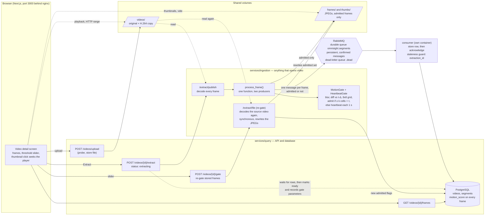

# Slice 3 · The frame pipeline, fed from files

An uploaded recording is decoded, gated frame by frame (Algorithm 1) and stored, so a
person can see which moments matter, move the threshold, and click a thumbnail to seek
the player. Built in OMNI-300 to OMNI-311; slice 4 (`slice-04-frames-from-camera.md`)
reuses everything from `process_frame()` onwards.

## What to know when reading it

- **Rows for every frame, JPEGs only for admitted ones.** A discarded frame keeps its
  `motion_score` so the gate can always be explained; only admitted frames cost disk.
- **Re-gating decodes the video again** (OMNI-306, on purpose): only admitted frames have a
  JPEG, so re-scoring stored frames could never bring a discarded frame back and the slider
  would work in one direction only. It updates the existing rows in place, so a row keeps its
  id across any number of re-gates. The cost is the decode: 1.4 to 2.0 s on the short clips
  measured, growing with the recording's length. The plan's "never re-read the video" was
  not followed, and a long recording is where that would show.
- **The queue sits between decoding and storing** so a slow database slows the consumer,
  not the decoder, and a crash between the two loses nothing: the message is acknowledged
  only after the row is committed (NFR-5).
- **Heartbeat.** Even a still scene admits one frame a second, so a quiet minute is not
  indistinguishable from a dead pipeline. It also puts a floor under retention
  (3% at 30 fps, measured in OMNI-318).
- **Measured** (`docs/results.md`): on fixed-camera footage the gate keeps 4.7 to 19.8% of
  frames; on daylight dash-cam footage 57%, because a moving camera changes the whole
  picture.
