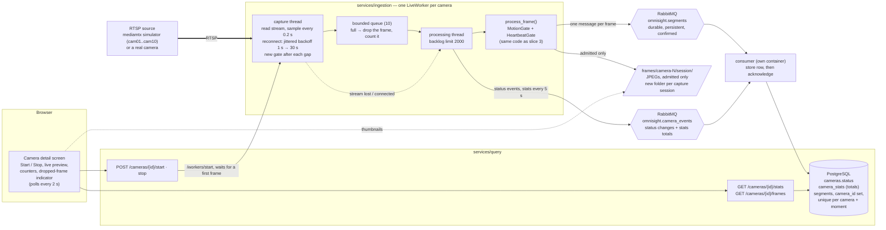

# Slice 4 · The same pipeline, fed from a camera through the queue

> The 0.2 s sampling shown here was removed in slice 5 (D-9); see slice-05-camera-wall.md.

A registered camera is captured continuously: one worker per camera reads its RTSP
stream, samples it, and hands every sampled frame to the **same** `process_frame()` slice 3
uses, then the same durable queue and the same consumer. Built in OMNI-312 to OMNI-317.
What is new is everything before `process_frame()` and the camera's own status and
counters.

## What to know when reading it

- **One `process_frame()`, two producers.** The only differences from slice 3 are
  `source_type="camera"`, a null `video_id`, a wall-clock timestamp, and a session folder
  per capture (a restarted worker counts frames from zero again).
- **Nothing accepted is lost.** A frame is *accepted* when the broker confirms the
  publish; the queue is durable and the consumer acknowledges after the commit. Checked
  live in OMNI-319: worker restarted gracefully, killed (`kill -9`), and the consumer
  stopped or killed for 15 s mid-capture, each with no gap in the stored frame indexes.
- **Two places where frames are shed on purpose.** The bounded in-process queue drops
  and counts frames when downstream falls behind (visible as the dropped counter), and
  the backlog limit stops a worker when the broker's queue is too deep.
- **Recovery without a person.** A dropped stream flips the camera to `unreachable`,
  the worker retries with growing backoff, and the status returns to `connected` by
  itself (about 11 s in the live check).
- **Known limits** (see `docs/results.md`): this machine sustains 8 simultaneous feeds,
  not 10; a file extraction at the same time pushes a live frame's latency to about 5 s
  (shared queue); and a restart of ingestion stops every worker, which nothing resumes,
  while the camera still reads `connected`.
