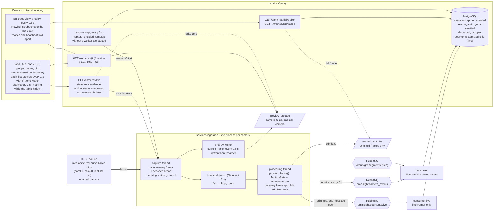

# Slice 5 · The camera wall

Every camera on one screen, each tile a small JPEG polled once a second, with an honest
state per camera, an enlarged view and a rewind through the last minutes. Under it, the
live pipeline changed shape: every frame is gated (Algorithm 1 as written), live frames
have a queue and a consumer of their own, each camera's worker runs in a process of its
own, and capture resumes by itself after a restart. Built in OMNI-500 to OMNI-512.

## What to know when reading it

- **Every frame is gated; only admitted frames are stored.** The 0.2 s sampling of slice 4
  is gone (D-9 done). A live camera's discarded frames are counted in `camera_stats`, not
  stored (D-5), and `captured = gated + dropped`, `gated = admitted + discarded` exactly.
- **Two queues, two consumers.** Live frames never wait behind a recording's burst:
  `omnisight.segments.live` and `consumer-live` are theirs alone (D-13). A live frame was
  stored in under 0.4 s with a 1,930-frame file extracting (it was 6.14 s).
- **The wall polls pictures, not streams.** Each tile asks for one small JPEG a second with
  its ETag; on a running feed that is a new picture every time (K-12), on a stalled one a 304.
- **State from evidence.** `live` needs a worker reading, frames arriving steadily and a
  preview at most 3 s old (D-15, D-17); `frozen`, `offline` and `stopped` are told apart, each
  labelled on its tile with the last frame dimmed. Nothing reads `live` without a worker.
- **Capture resumes by itself.** Query starts every camera with `capture_enabled` that has no
  worker, every 5 s, so an ingestion restart or kill is recovered in about 11-14 s (D-15).
- **A process per camera.** Each camera's worker runs in a child process with one decoder
  thread and one OpenCV thread (D-18), and buffers about 2 s of frames (D-20).
- **The rewind buffer is the stored admitted frames** (D-16): a flip-book of the last
  minutes, at least one frame a second, more when something moves.
- **Known limits** (see `docs/results.md`, `docs/known-issues.md`): this machine sustains 3
  live feeds, and NFR-4 is revised to that, per machine of this class (D-19); a stalled
  stream reads `offline` after about 30 s, not 10 (K-13); the wall's preview polls are
  almost never 304s on a running feed (K-12).
