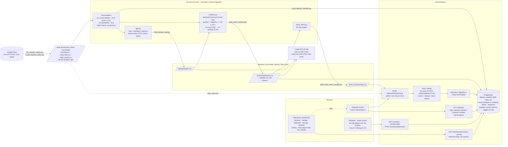

# Slice 6 · Real footage, and the dashboard comes alive

The three datasets become labelled data the forecasting slices can train on: every clip
listed by a loader, split once, its lead-up windows derived from annotations and exported,
a sample of them checked by eye. The hand-check sample enters the product as ordinary
footage, through the same function as an upload. Over everything, an Operations Dashboard
whose every figure leads to its screen, kept fast by an hourly rollup. Built in OMNI-600 to
OMNI-613.

## What to know when reading it

- **Every window comes from an annotation.** UCF-Crime's test videos use the official times,
  its training videos UCA's, picked by a written rule (D-21); CCD its first accident frame.
  An event with no time gets no window, and the reason is written to `_skipped.csv` (D-24).
- **The split comes first and never moves** (D-22). Windows take their clip's split; CCD
  clips from one YouTube video stay on one side. Rebuilding the split, the windows or the
  sample must give identical bytes, or the script stops and writes nothing.
- **Dataset footage is ordinary footage** (D-25). The load endpoint loops over
  `store_video()`, the same function as an upload, then extracts with the same gate. Only
  `source = dataset` and no retention date differ.
- **The product holds only the hand-check sample** (D-26): 60 clips, 30 per dataset. The
  model measurements run on Colab's GPU from Drive with the same `services/common` code and
  the committed CSVs; the full datasets never enter the product.
- **The dashboard reads a rollup.** Triggers on `segments` keep `segment_hourly` exact in
  the same transaction as each insert or delete (D-28), so the summary does not count
  146,807 rows on every refresh.
- **The SM-3 target is set** from CCD's held-out pre-event footage by a rule written first
  (D-23): mTTA ≥ 1.80 s.
- **Known limits** (`results.md`, `known-issues.md`): UCA-timed windows are wrong twice as
  often as official ones (K-20, before slice 9 trains); about 1 GB of files on disk have no
  row and are not in the storage figure (K-21); the gate still reads camera motion as scene
  motion (K-4, slice 7); NFR-4 stays at 3 live feeds per machine after the one-operation grid
  (D-19, OMNI-613).
