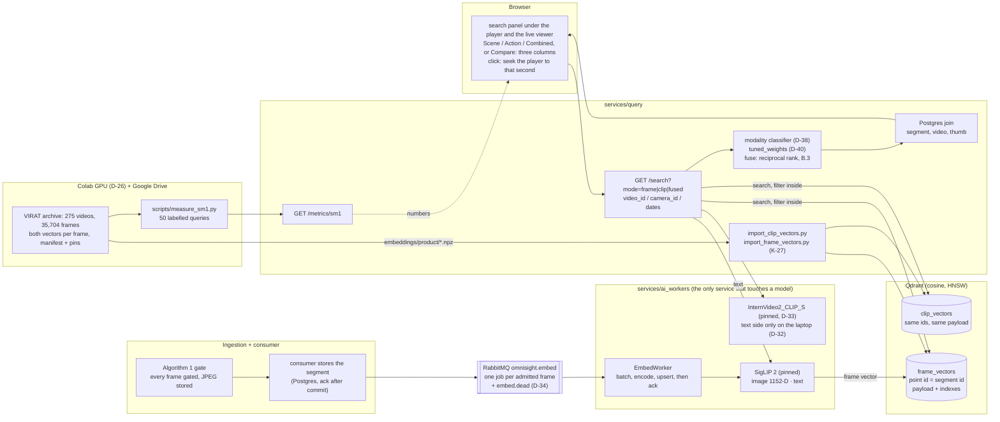

# Slices 7 and 8 · Search: two vectors per frame, one fused answer

Every admitted frame gets a scene vector (SigLIP 2) and an action vector (InternVideo2), and a
sentence typed in the player finds the moments: the sentence is encoded by both models, each
vector collection is searched with the video's filter inside the search, and Algorithm 3 merges
the two lists by rank. Built in OMNI-700 to OMNI-717.

## What to know when reading it

- **Every admitted frame gets a vector.** Nothing is skipped to keep up; the queue is durable
  and an upsert is idempotent (a rerun changes nothing), so a lost worker loses no frame.
- **Only `ai_workers` touches a model.** `query` sends text to it and gets a vector back; the
  weights, the classifier and the fusion run in `query`.
- **Frame vectors come from two places.** Live and uploaded footage is encoded on this
  laptop's CPU (about 9 s a frame, K-25). The product's 9 VIRAT videos take theirs from the
  Colab archive (cosine 0.99998 or better against the laptop's, OMNI-708). Clip vectors exist
  only for the 9 VIRAT videos: a camera has none (D-32), so a live frame is found by scene only.
- **Search lives where the footage is watched** (D-39): inside the video player and the camera
  viewer, on that footage only. The filter is applied inside both HNSW searches, so a video's
  best match is found even when other footage ranks above it.
- **Fusion** is Algorithm 3 as written (reciprocal rank, `K` = 5), with the classifier's
  weights replaced by fixed ones per kind of query (D-40, a deviation): scene 0.5 / 0.5,
  action 0.6 frame / 0.4 clip. Compare shows the three modes side by side.
- **SM-1 and TC-4 run on the archive, not the laptop.** SM-1 on Colab with the same
  `services/common` code (76.0% against 85%, K-30); TC-4 on the laptop's Qdrant with scratch
  collections (74%, at the archive's 35,704 frames, not 100,000, D-37).
- **Known limits** (`results.md`, `known-issues.md`): action queries are no better than
  frame-only (K-30); the first search after
  an idle waits for the model to load from disk (K-26); one GPU holds about 9 frames a second
  (K-31); a camera keeps frames, not a recording (K-29).
